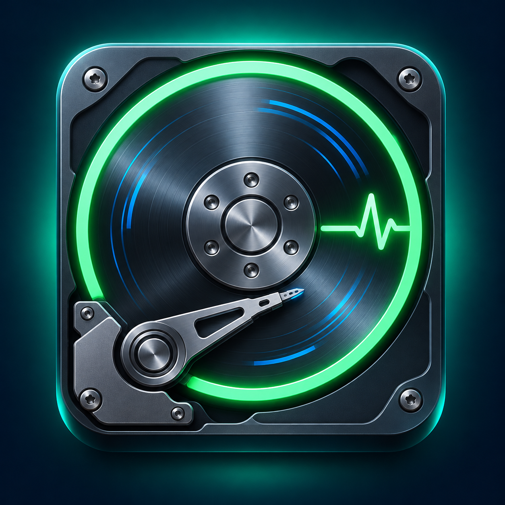
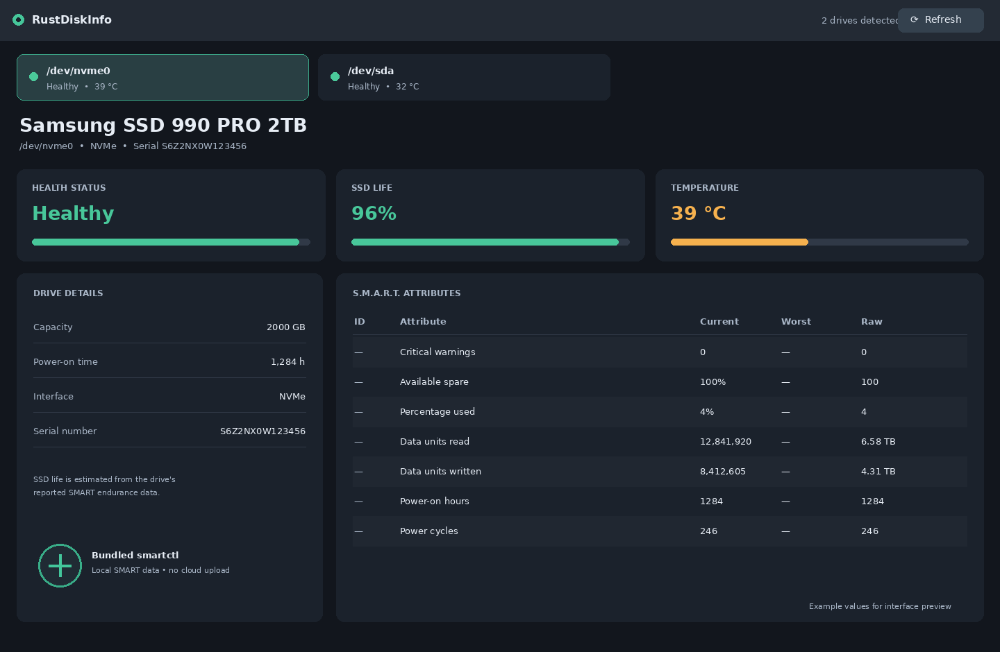

<div align="center">
  

  # RustDiskInfo

  **A clear view of your drive health.**

  A Linux S.M.A.R.T. monitor built with Rust and egui, inspired by CrystalDiskInfo and [QDiskInfo](https://github.com/edisionnano/QDiskInfo).

  
  
  
  
</div>

---

## Preview



*Example interface with sample values.*

## Overview

RustDiskInfo presents health and S.M.A.R.T. attributes for detected drives in a dark desktop interface. The drive selector, health and temperature panels, device details, and attribute table follow the information layout of QDiskInfo.

### Features

- Detected drives, model, capacity, serial number, and interface
- S.M.A.R.T. health status, temperature, and power-on hours
- SSD life estimate from NVMe percentage used or supported ATA endurance attributes
- Detailed ATA and NVMe S.M.A.R.T. attributes
- Manual refresh without another password prompt during the same app session
- Bundled smartctl and drive database

## Requirements

- Linux desktop with X11
- Rust and Cargo to build the application
- C++ compiler and GNU make to build the bundled smartctl
- PolicyKit (`pkexec`) for the one-time authorization at app startup

The smartmontools 7.5 source archive is included in `vendor`. The build script verifies its SHA-256 and builds smartctl; installing smartmontools system-wide is not required.

## Build

```bash
./scripts/build.sh
```

The release binary is written to `build/release/rustdiskinfo`.

## Install

```bash
sudo ./scripts/install.sh
```

The installer adds the app, bundled smartctl, drive database, icon, and desktop shortcut to the invoking user's profile. It installs a root-owned helper under `/usr/local/libexec/rustdiskinfo` so the app can request authorization once and keep the SMART session open for subsequent refreshes. It does not configure autostart.

To install an already-built application binary, pass its path:

```bash
sudo ./scripts/install.sh /path/to/rustdiskinfo
```

## Project status

This is an early release. Available SMART attributes depend on the drive and controller. SSD life is shown only when the drive reports an endurance value RustDiskInfo can interpret.

## Credits and licenses

The interface and information flow are inspired by [QDiskInfo](https://github.com/edisionnano/QDiskInfo), licensed under GPL-3.0.

The bundled [smartmontools](https://github.com/smartmontools/smartmontools) source is licensed under GPL-2.0-or-later. See [THIRD_PARTY_NOTICES.md](THIRD_PARTY_NOTICES.md) for details.

This project is licensed under [GNU GPL-3.0-or-later](LICENSE).
